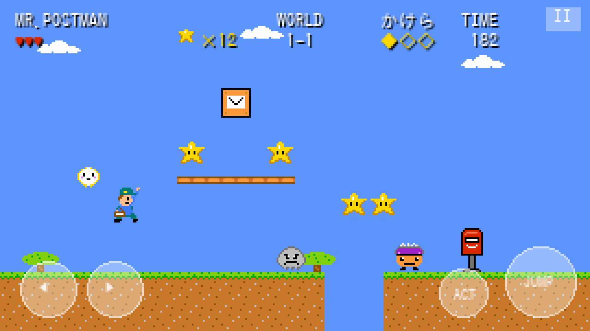
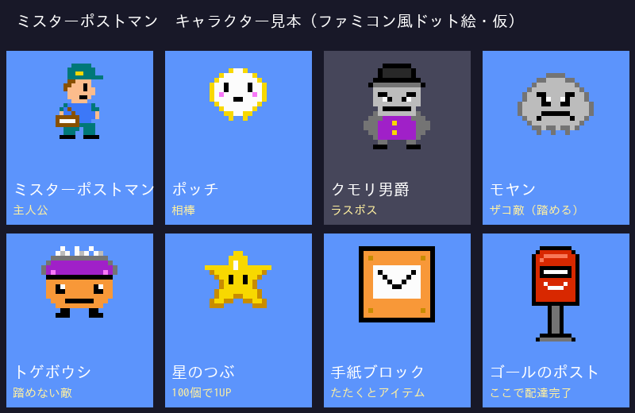
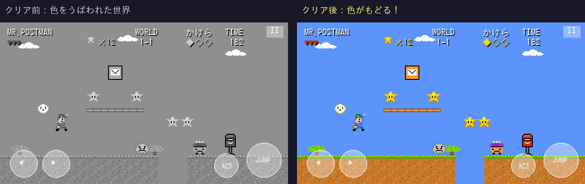

# 計画書：『ミスターポストマン』（スマホ向け横スクロール・アクション）

> 「スーパーマリオのような」＝**横スクロールで走ってジャンプし、敵を踏んでゴールを目指す**ジャンル（プラットフォーマー）を指します。
> 既存作品のキャラクター・名前・絵・音楽・ステージは使わず、**すべてオリジナル**で作ります。

## 0. 決定事項

| 項目 | 決定内容 |
|---|---|
| タイトル | **ミスターポストマン** |
| 見た目 | **ファミコン風ドット絵**（色数を絞った、昔のテレビゲーム風） → サンプル画像で確認中 |
| 対象年齢 | **小学校高学年以上** |
| 公開方法 | **まずはWeb**（スマホのブラウザで遊ぶ） |
| ストーリー量 | **会話は1場面あたり2〜5往復**。小学生が理解できる言葉で、短く |

---

## 1. コンセプト

**「色をうばわれた島々を、配達しながら取りもどす」**

- ステージをクリアするたびに、灰色だった世界に**色が戻る**のがごほうび。
- スマホで **1ステージ 2〜3分**。

---

## 2. 見た目サンプル（ファミコン風・仮）

| ファイル | 内容 |
|---|---|
| `images/sample_gameplay.png` | プレイ画面（スマホ横向き、タッチボタン付き） |
| `images/sample_characters.png` | キャラクター見本 |
| `images/sample_color_return.png` | クリア前（灰色）→ クリア後（色が戻る）の比較 |

---

## 3. 登場人物

| 名前 | 役割 | 見た目 |
|---|---|---|
| **ミスターポストマン** | 主人公。島の郵便屋さん。手紙を届けることに一生けんめい。みんなからこう呼ばれている | 青緑の帽子と制服、茶色の配達カバン |
| **ポッチ** | 相棒。小さな光の精霊。ヒントをくれる | 白く光る丸い姿 |
| **クモリ男爵** | 敵のボス。灯台の光をうばった | 灰色の顔、黒いシルクハット、紫の服 |
| **ドンヨリ団** | 男爵の手下たち（モヤン、トゲボウシなど） | 灰色・くすんだ色 |

---

## 4. 筋書き

### あらすじ（説明書・タイトル画面用）
空に浮かぶ「ソラツギ諸島」は、**ニジ灯台**の光でつながっていた。
ある日、クモリ男爵が灯台の燃料「**ヒカリのかけら**」をうばい、島から色が消えてしまった。
島をつなぐ光の橋も消え、手紙が届けられない。
**「手紙を待っている人がいる。ぼくが届ける！」**
ミスターポストマンの配達の旅が始まる。

### 章の流れ

| 章 | 舞台 | できごと | ボス |
|---|---|---|---|
| 1章 | はじまりの草原島 | ポッチを助け、最初の灯台に光を戻す | 大ガエル「ゲコドン」 |
| 2章 | カラカラ砂丘島 | 男爵が「元・灯台守」だったと知る | 砂ムカデ「ザラザラ」 |
| 3章 | ツララ雪原島 | 男爵あての手紙がたくさん届いていたと分かる | 雪だるま将軍 |
| 4章 | シズク海底島 | 最後の手紙を見つける | 大ダコ「ヌルリン」 |
| 5章 | クモリ城 | 男爵と対決し、手紙を届ける | クモリ男爵 |

**テーマ**：男爵は昔、灯台守だった。誰にもお礼を言われず、心が曇ってしまった。
最後にミスターポストマンが届けるのは、**島の人たちから男爵への「ありがとう」の手紙**。

---

## 5. 会話シナリオ（各場面2〜5往復）

> 1行は短く（スマホ1行に収まる長さ）。むずかしい漢字にはゲーム内でふりがなを付ける。

### プロローグ（ゲーム開始時）
- **ポストマン**：あれ？　島の色が消えてる！
- **ポッチ**：たすけて！　男爵が灯台の光をうばったの。
- **ポストマン**：光がないと、橋がわたれない…。手紙が届けられないよ！
- **ポッチ**：かけらを取りもどせば、光がもどるよ。
- **ポストマン**：よし、配達に出発だ！

### 1章クリア後
- **ポッチ**：見て！　草原に色がもどったよ！
- **ポストマン**：やった！　次の島への橋もかかった！
- **ポッチ**：あと4つ。いっしょにがんばろう！

### 2章クリア後
- **ポストマン**：遺跡に古い写真があった。灯台と…男爵？
- **ポッチ**：男爵は、むかし灯台守だったんだって。
- **ポストマン**：どうして光をうばったんだろう…。

### 3章クリア後
- **ポッチ**：この郵便ポスト、手紙でいっぱい！
- **ポストマン**：全部、男爵あてだ。島のみんなからだよ。
- **ポッチ**：でも、ずっと届いてなかったんだね…。
- **ポストマン**：ぼくが届ける。それが仕事だから！

### 4章クリア後
- **ポッチ**：これが最後の手紙？
- **ポストマン**：うん。あとは男爵に届けるだけだ。
- **ポッチ**：クモリ城へ行こう！

### 最終決戦の前（クモリ城）
- **男爵**：灯台を守っても、だれもお礼を言わなかった！
- **ポストマン**：ちがう！　みんな手紙を書いていたんだ。
- **男爵**：うそだ！　そんなもの、とどいていない！
- **ポストマン**：だから今、届けに来た！

### エピローグ（クリア後）
- **ポストマン**：男爵、お届けものです。
- **男爵**：…「いつも光をありがとう」…。
- **男爵**：わたしは…ずっと、ひとりだと思っていた。
- **ポッチ**：見て！　全部の灯台が光ってる！
- **ポストマン**：さあ、今日も配達だ！

---

## 6. 遊び方（基本ルール）

- 右へ進み、ステージ最後の「**ポスト**」に触れるとクリア（配達完了）。
- 敵は**上から踏む**と倒せる。横から当たるとダメージ。
- ライフ：ハート3つ（穴に落ちると即ミス）。チェックポイントあり。
- 集めるもの
  - **星のつぶ**：100個で1UP
  - **ヒカリのかけら**：各ステージに3個隠されている（やりこみ要素）
- **手紙ブロック**：下からたたくとアイテムが出る。

### 難しさ（小学校高学年以上向け）
- 1章はやさしく、章が進むごとに少しずつ難しくする。
- 3章以降は「動く足場」「すべる床」など、考えて跳ぶ場面を入れる。
- ミスしても、チェックポイントからすぐ再開できるようにして、イライラを減らす。

### パワーアップ
| アイテム | 効果 |
|---|---|
| バネぐつ | 2段ジャンプ |
| ランタン | 光の玉を投げて敵を倒す |
| 紙ひこうきマント | 長押しでゆっくり滑空 |
| 大きな配達カバン | ダメージを1回防ぐ |

### 敵キャラ
- **モヤン**：歩くだけの灰色の雲。踏める。
- **トゲボウシ**：頭にトゲ。踏めない。
- **パタクモ**：空を上下に飛ぶ。
- **ドンヨリ兵**：近づくと走ってくる。

---

## 7. スマホ操作

- **画面は横向き**。
- 左下：**◀・▶ボタン**、右下：**JUMP（大）**と**ACT（小）**、右上：**一時停止**。
- 押す長さでジャンプの高さが変わる。
- 遊びやすさの補正
  - 足場から落ちた直後でも、少しの間はジャンプできる
  - 着地の少し前に押したジャンプも有効にする
  - ボタンの反応範囲は見た目より広くする
- アプリを切り替えたら**自動で一時停止**。

---

## 8. 技術方針

| 項目 | 方針 |
|---|---|
| 形式 | **Webブラウザで動くゲーム（HTML5）**。インストール不要 |
| 言語 | JavaScript |
| 描画 | HTML5 Canvas。ドット絵がぼやけないよう、拡大時はなめらか補正を切る |
| 画面サイズ | 小さい画面で描いて、スマホ画面に合わせて整数倍に拡大 |
| 公開 | GitHub Pages など |
| ステージ | 文字の表（データ）で作り、後から追加しやすくする |
| 保存 | 端末内にクリア状況を保存 |

---

## 9. 開発の進め方

| 段階 | 内容 | 完成の目安 |
|---|---|---|
| **Step 1：試作** | 主人公が走る・跳ぶ・床に立つ。タッチボタン | スマホで操作が気持ちいい |
| **Step 2：1ステージ** | モヤン、星のつぶ、ゴールのポスト、ミスと再開 | 1-1が最後まで遊べる |
| **Step 3：ゲームの形** | タイトル、プロローグ会話、ステージ選択、セーブ | 「ゲーム」として成立 |
| **Step 4：1章完成** | 1-1〜1-3＋ボス、パワーアップ、色が戻る演出 | 1章を通して遊べる |
| **Step 5：音** | 効果音、BGM（ファミコン風の音） | 雰囲気が完成 |
| **Step 6以降** | 2〜5章を追加 | 全5章完成 |

---

## 10. 注意点（権利）

- ジャンル（横スクロールで跳んで敵を踏む）自体は自由に使えるが、既存ゲームのキャラクター・絵・音楽・ステージ配置はまねない。
- 外部の絵や音を使う場合は、利用規約（商用利用・クレジット表記）を確認する。
- 「ミスターポストマン」に似た名前の歌や作品が既にある。将来、有料販売などをする場合は、商標を[J-PlatPat（特許情報プラットフォーム）](https://www.j-platpat.inpit.go.jp/)で事前に確認する。
